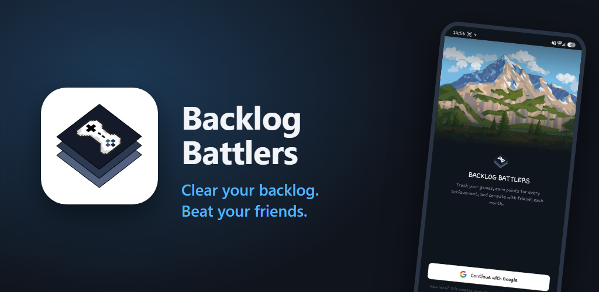
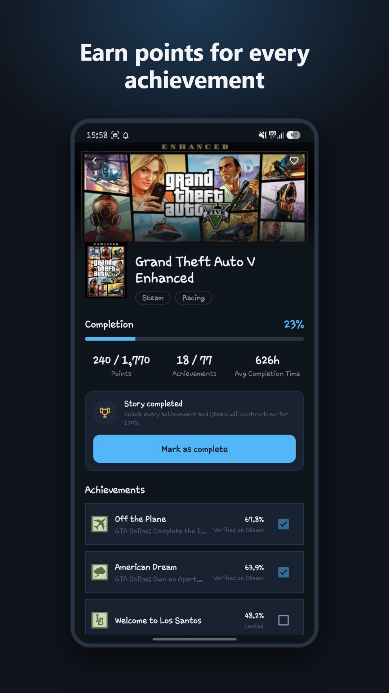
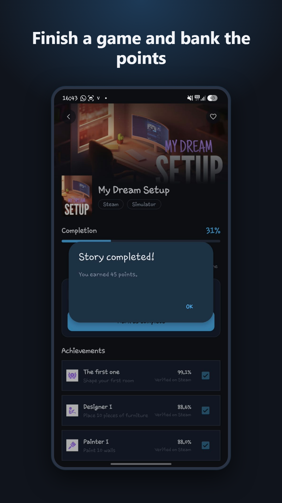
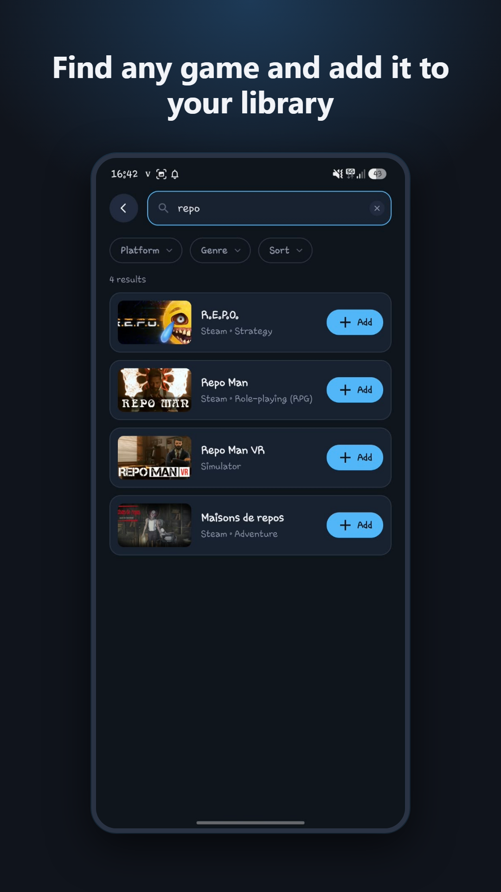
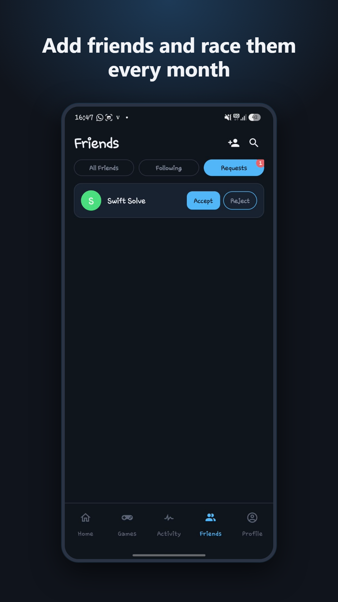
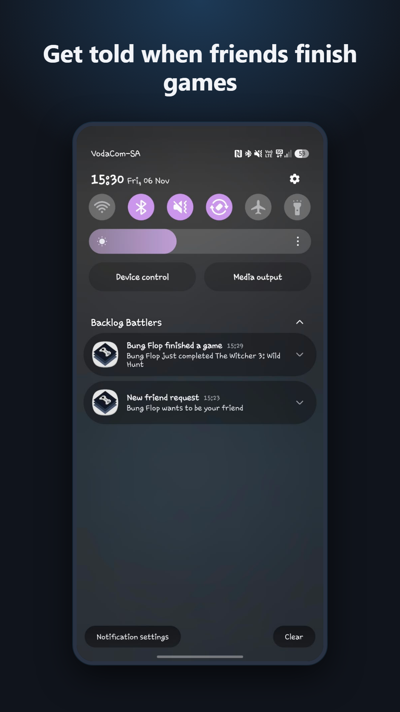
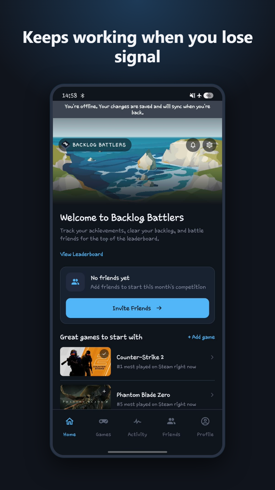
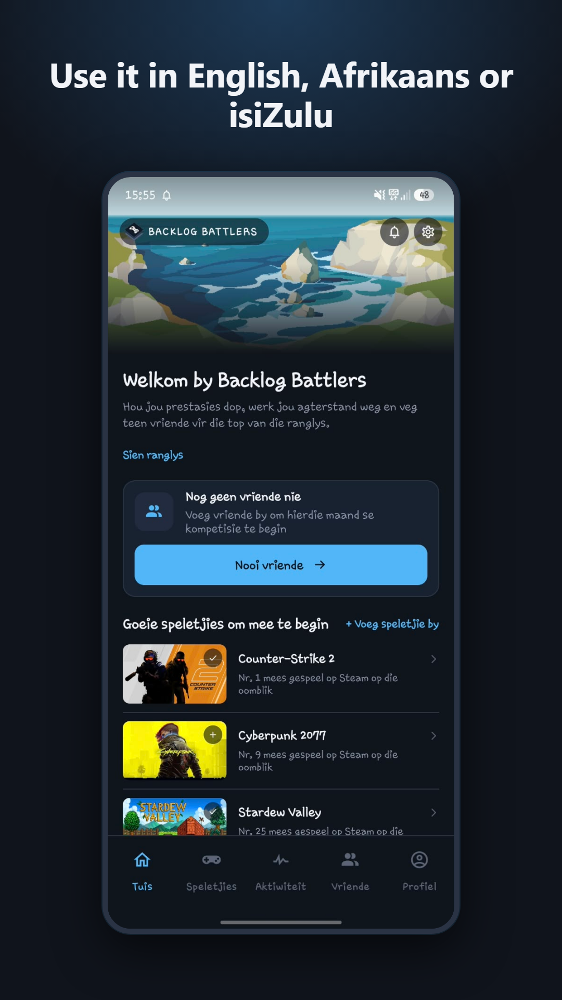
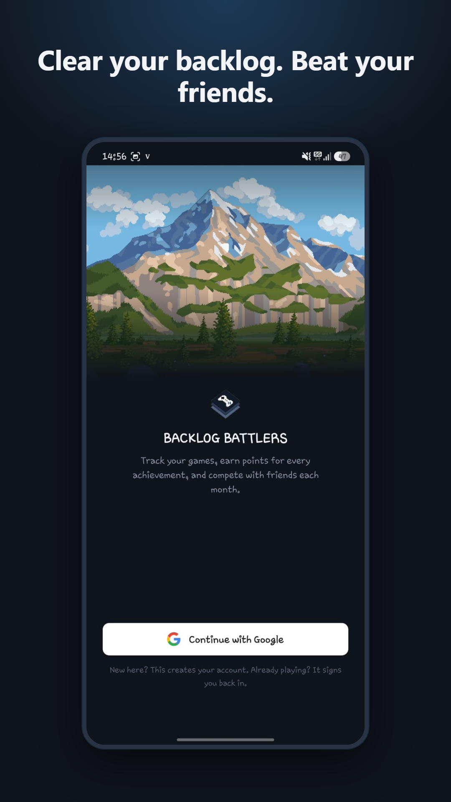

# Backlog Battlers: Mock Google Play Review Process

This document goes through each Google Play requirement and gives our response.

**Why this is a mock process.** Backlog Battlers is a PROG7314 Portfolio of Evidence project built by Dylan Jurgens, Andre Fourie and Mihir Jagdaw. The POE asks us to prepare the app for the Google Play Store, with a signed production APK and promotional screenshots. It does not ask us to publish. Publishing costs money and puts a student project in front of the public which is against EMERIS policy and we'd have to notify EMERIS first, so we stopped before that point. It was also mentioned during lectures for PROG7314 that we would not have to follow through with the publishing process, but only prepare for it.

Everything we could make without a Play developer account is in this folder. For the steps that need a paid account, we explain how we qualify and what we would do. Those steps are marked At submission. They are planned steps which would occur if the app was genuinly going to be published.

## Status key

| Status | Meaning |
|---|---|
| **Provided** | The file is in this folder and linked below |
| **Answered** | The form is a google play console form we researched but cannot fill out, so our answers are in [forms/](forms/) which compiles all the questions and answers |
| **At submission** | Needs the paid developer account. We describe what we would do |

## Summary

| # | Requirement | Status | Evidence |
|---|---|---|---|
| 1 | Developer account and identity verification | At submission | [Section 1](#1-developer-account) |
| 2 | Closed test with 12 testers for 14 days | At submission | [Section 2](#2-testing-before-production) |
| 3 | Signed Android App Bundle and APK | Provided | [release/](release/) |
| 4 | Target API level and technical requirements | Provided | [Section 4](#4-technical-requirements) |
| 5 | Store listing text | Answered | [forms/store-listing.md](forms/store-listing.md) |
| 6 | Store graphics and screenshots | Provided | [graphics/](graphics/), [screenshots/](screenshots/) |
| 7 | Contact details and website | Provided, website at submission | [Section 7](#7-contact-details-and-website) |
| 8 | Privacy policy at a public URL | Provided | [privacy-policy.md](privacy-policy.md) |
| 9 | App access instructions for reviewers | Answered | [forms/app-content.md](forms/app-content.md#app-access) |
| 10 | Ads declaration | Answered | [forms/app-content.md](forms/app-content.md#ads) |
| 11 | Content rating questionnaire | Answered | [forms/app-content.md](forms/app-content.md#content-rating) |
| 12 | Target audience | Answered | [forms/app-content.md](forms/app-content.md#target-audience-and-content) |
| 13 | Data safety form | Answered | [forms/data-safety.md](forms/data-safety.md) |
| 14 | Account deletion in the app and on the web | Provided | [Section 14](#14-account-deletion) |
| 15 | Other declarations (news, government, financial, health) | Answered | [forms/app-content.md](forms/app-content.md#other-declarations) |
| 16 | Policy compliance | Known issue (profile pictures) | [Section 16](#16-policy-compliance) |
| 17 | Review and release | At submission | [Section 17](#17-review-and-release) |

---

## 1. Developer account

**Requirement.** A Google Play developer account costs a once off fee of 25 dollars. Google checks the developer's legal name and address against a government ID. It also checks the contact email and phone number. New personal accounts must prove they have a physical Android phone through the Play Console app.

**Our response. At submission.**
- I (Dylan | ST10434135) would register a **personal** developer account with dylanjurgens10@gmail.com. An organisation account needs a DUNS number, which our student team (Dylan Jurgens, Andre Fourie and Mihir Jagdaw) doesn't have.
- We would pay the US$25 fee by card when signing up.
- I (Dylan | ST10434135) would verify my identity with my South African ID.
- I (Dylan | ST10434135) would use my Samsung Galaxy A55 5G for the phone check. It is the phone we tested the app on.
- The account would register the package name `com.backlogbattlers.app`. This also covers Android's developer verification for installs outside Play.

## 2. Testing before production

**Requirement.** Personal developer accounts made after 13 November 2023 must run a closed test first. At least 12 testers must stay opted in for 14 days in a row. Only then can the account apply for production access.

**Our response. At submission.** The rule depends on when the developer account is made. Ours would be new, so the rule applies for us. Our plan would be to:
1. Upload the signed bundle to the **Internal testing** track first. It has no waiting period, so the team can install from Play straight away.
2. Create a **Closed testing** track with at least 12 testers. These are our team members and classmates from the module.
3. Share the opt in link and keep every tester opted in for 14 days in a row. Any API fix deploys on merge to `main` through [GitHub Actions](https://github.com/mihirjagdaw/PROG7314-Part3-BacklogBattlers/actions).
4. Answer Play Console's production access questions about the test.

## 3. Signed release build

**Requirement.** New apps are uploaded as an Android App Bundle (AAB), signed with an upload key. Google signs the installed app with its own key (Play App Signing).

**Our response. Provided.**

| File | What it is |
|---|---|
| [release/backlog-battlers-1.0.aab](release/backlog-battlers-1.0.aab) | The bundle we would upload to Play Console |
| [release/backlog-battlers-1.0.apk](release/backlog-battlers-1.0.apk) | The signed production APK the brief asks for. Same build and same key as the bundle |
| [release/signing-certificate.txt](release/signing-certificate.txt) | `apksigner verify` output. It shows the build is signed with our release key, not the debug key |

Both are version 1.0 (version code 1) of the `release` build. We made them with Android Studio's **Generate Signed App Bundle or APK** wizard. The upload keystore is kept outside the repository. The `.gitignore` also blocks `*.jks` and `*.keystore` files.

**At submission:** we would turn on Play App Signing. We would then add the fingerprint (`SHA-1`) of Google's signing key to our Android OAuth client in Google Cloud Console. Without it, Google sign in fails on installs from Play.

## 4. Technical requirements

We checked the signed build with the Android SDK tools. The full output is in [release/signing-certificate.txt](release/signing-certificate.txt).

| Requirement | Ours | Where to check |
|---|---|---|
| New apps must target API 36 (Android 16) or higher from 31 August 2026 | Targets API 37 | `app/build.gradle.kts`, `targetSdk = 37` |
| Minimum Android version | Android 8.0 (API 26) | `app/build.gradle.kts`, `minSdk = 26` |
| Release traffic encrypted | HTTPS only. Plain HTTP is only allowed in debug builds | `app/src/debug/AndroidManifest.xml` |
| Notification permission asked at runtime on Android 13 and up | Yes | `MainActivity.kt`, `POST_NOTIFICATIONS` in `AndroidManifest.xml` |
| Sign in tokens protected | Encrypted with an Android Keystore key and left out of backups | `res/xml/data_extraction_rules.xml`, `res/xml/backup_rules.xml` |
| No sensitive permissions that need a Permissions Declaration | None. The build only asks for internet, network state, notifications and biometrics, plus what Firebase messaging needs | [release/signing-certificate.txt](release/signing-certificate.txt), Permissions |
| No advertising ID | Not in the build | [release/signing-certificate.txt](release/signing-certificate.txt), Permissions |
| Native code supports 16 KB memory pages | Yes. The only native library (`libdatastore_shared_counter.so`, from AndroidX DataStore) passes for all four architectures | [release/signing-certificate.txt](release/signing-certificate.txt), 16 KB page support |
| Signing key valid until after 22 October 2033 | Valid until 31 October 2051 | [release/signing-certificate.txt](release/signing-certificate.txt) |

## 5. Store listing

**Requirement.** An app name (up to 30 characters), a short description (up to 80), a full description (up to 4,000), a category and release notes.

**Our response. Answered.** Every field is in [forms/store-listing.md](forms/store-listing.md). The character counts are checked against Play's limits.

| Field | Value |
|---|---|
| App name | Backlog Battlers |
| Short description | Earn points for your game achievements and race your friends every month. |
| Category | Entertainment |
| Price | Free, with no ads and no purchases in the app |

## 6. Graphics and screenshots

**Requirement.** A 512 x 512 icon and a 1024 x 500 feature graphic. Between 2 and 8 phone screenshots, with no side more than twice the other.

**Our response. Provided.**

| App icon (512 x 512, PNG with alpha) | Feature graphic (1024 x 500) |
|---|---|
|  |  |
| [app-icon-512.png](graphics/app-icon-512.png) | [feature-graphic-1024x500.png](graphics/feature-graphic-1024x500.png) |

I (Dylan | ST10434135) took the screenshots on my Samsung Galaxy A55 5G against the hosted API. We placed each one on a branded background with a caption at a resolution of 1080 x 1920.

| | | | |
|---|---|---|---|
|  |  |  |  |
|  |  |  |  |

## 7. Contact details and website

**Requirement.** A public contact email. A website is optional.

**Our response.**
- **Contact email. Provided.** I (Dylan | ST10434135) am the contact, at dylanjurgens10@gmail.com.
- **Website. At submission.** We would host a single page for the app on GitHub Pages at `https://mihirjagdaw.github.io/PROG7314-Part3-BacklogBattlers/`. It would show the screenshots and link to the privacy policy. Until then the [repository](https://github.com/mihirjagdaw/PROG7314-Part3-BacklogBattlers) serves as the website.

## 8. Privacy policy

**Requirement.** A privacy policy at a public URL. It must say what data is collected, how it is used, who it is shared with and how to delete it.

**Our response. Provided.** [privacy-policy.md](privacy-policy.md) is public at:

https://github.com/mihirjagdaw/PROG7314-Part3-BacklogBattlers/blob/main/play-store/privacy-policy.md

The app shows the same summary under Settings > About > Privacy Policy.

## 9. App access

**Requirement.** Reviewers must be told how to get past any sign in.

**Our response. Answered.** Reviewers are required to have a, and sign in with any Google account. The first sign in creates the account, so no test login is needed. See [forms/app-content.md](forms/app-content.md#app-access).

## 10. Ads

**Our response. Answered.** No ads, and no ad or analytics SDKs in `app/build.gradle.kts`. See [forms/app-content.md](forms/app-content.md#ads).

## 11. Content rating

**Requirement.** The IARC questionnaire, which sets the app's age ratings (for example ESRB in the United States and PEGI in Europe).

**Our response. Answered.** Our answers are in [forms/app-content.md](forms/app-content.md#content-rating). The app has no violent or sexual content of its own. Users interact through friends and the leaderboard, with no chat. IARC issues the rating when the questionnaire is submitted, so that part is **at submission**.

## 12. Target audience

**Our response. Answered.** Ages 13 and over. The app is not aimed at children, so the Families policy does not apply. See [forms/app-content.md](forms/app-content.md#target-audience-and-content).

## 13. Data safety

**Requirement.** A declaration of the user data the app collects or shares, and why. Google checks it against the app during review.

**Our response. Answered.** [forms/data-safety.md](forms/data-safety.md) links each answer to the database table that holds the data. The app collects the Google account's name, email and IDs, the user's game activity, a push token and server request logs. None of it is shared. All of it is encrypted in transit and deleted on request.

## 14. Account deletion

**Requirement.** Apps with accounts must let users delete their account in the app. They must also give a web link for deletion requests.

**Our response. Provided.**
- **In the app:** Settings > Delete Account, after a confirmation. It calls `DELETE /users/me` (`api/src/main/kotlin/com/backlogbattlers/api/routes/AccountRoutes.kt`). Every user table uses `ON DELETE CASCADE`, so one delete removes everything. `AccountRoutesTest.kt` tests this.
- **On the web:** the [Delete your account](privacy-policy.md#delete-your-account) section of the privacy policy.

## 15. Other declarations

**Our response. Answered.** Not a news, government, financial or health app, and no COVID features. See [forms/app-content.md](forms/app-content.md#other-declarations).

## 16. Policy compliance

| Policy | Our position                                                                                                                                                                                                                                                                                                                                                                                                                                                                                                          |
|---|-----------------------------------------------------------------------------------------------------------------------------------------------------------------------------------------------------------------------------------------------------------------------------------------------------------------------------------------------------------------------------------------------------------------------------------------------------------------------------------------------------------------------|
| Intellectual property (store listing) | The listing and graphics only use our own artwork and name. Game covers in the screenshots come from the IGDB catalogue. The full description says the app is not affiliated with Steam or IGDB                                                                                                                                                                                                                                                                                                                       |
| Intellectual property (inside the app) | **Known issue.** The 32 bundled profile pictures (`app/src/main/res/drawable-nodpi/pfp_01.jpg` to `pfp_32.jpg`) show characters owned by other companies. Play would reject them if we did not have copyright/ usage permission. So we would obtain permission before usage. If permission was not granted, we would update the app and remove them to respect this decision. |
| User data | Covered by the privacy policy and the data safety answers. Users can delete their account in the app                                                                                                                                                                                                                                                                                                                                                                                                                  |
| User interaction | Users only see each other's profile and game progress. There is no chat or messaging                                                                                                                                                                                                                                                                                                                                                                                                                                  |
| Deceptive behaviour | The listing only describes features in this build. Each one is shown in the README and the demo video                                                                                                                                                                                                                                                                                                                                                                                                                 |

## 17. Review and release

**Our response. At submission.** Once the closed test in [Section 2](#2-testing-before-production) passes and production access is approved, we would:
1. Create a production release from the same signed bundle, with the release notes from [forms/store-listing.md](forms/store-listing.md#release-notes-whats-new-in-10).
2. Release in South Africa first.
3. Send it for review. Google usually reviews new apps within a week.
4. Roll it out to a small share of users first. We would watch the Azure log stream and Play Console's reports to make sure everything is in order before releasing to everyone.
